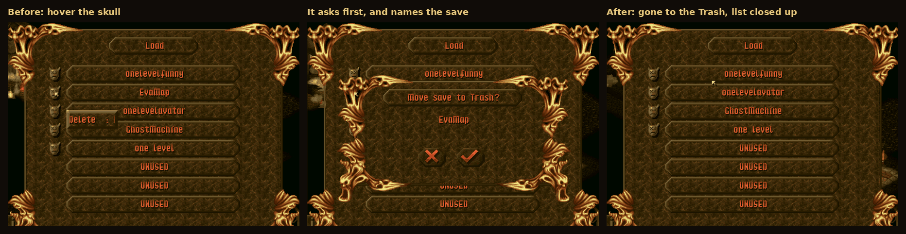
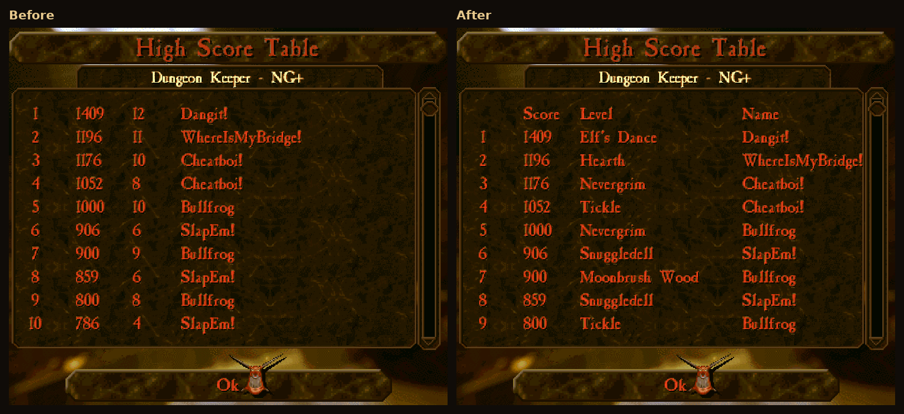
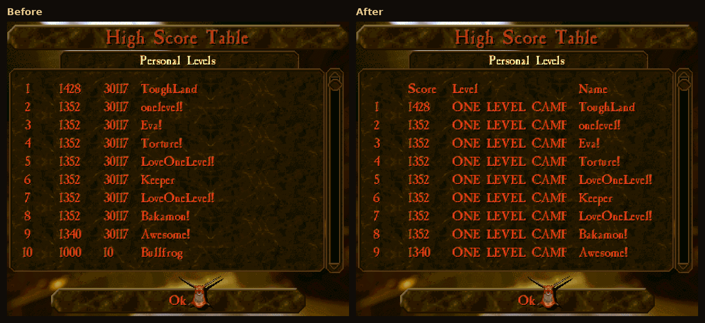

# What the Tux Edition adds on top of upstream

[← Back to the README](../README.md)

**Upstream supports Linux — as source code.** Their CMake build compiles natively on Linux, and their CI
builds a Linux binary to test pull requests; you can compile KeeperFX on Linux today. What you can't do
is *download* it. Their release pipeline cross-compiles to Windows with MinGW, and every release from 2024
to the current **v1.4.0** ships exactly one file:
`keeperfx_1_4_0_complete.7z`, a Windows package. Their download page lists Linux as *"Not available yet —
coming soon"*, and there's an open pull request to build an AppImage on their CI
([#4990](https://github.com/dkfans/keeperfx/pull/4990)) — good news, and we'll happily stand down the day
it lands. Until then the Linux path ends at a compiler: no released build, no installer, no launcher.

**This edition is that missing half, and only that half.** Every week a bot merges the team's latest
`master` here — with its Windows-only parts stripped out, proven not to change the game — builds and
tests it and opens a pull request, so the *game* is theirs and stays current — never a stale snapshot
frozen at whatever built cleanly once. On top of it sits the part nobody else
maintains: a ready-to-run **AppImage, Flatpak and Arch package**, a native Qt launcher that doesn't touch
Wine, and the Linux-specific fixes, hardening and performance work below.

> **At a glance — everything here is a curated Linux layer, not a rewrite of the game.** We don't chase
> upstream's headline count; the team ships the *game*, and our job is the platform work they don't do,
> plus the bugs we find on the way. That layer is real, and every line of it is traceable to a commit in this repo:
>
> 
>
> | | What we added | Roughly |
> |---|---|---|
> | 🐧 | **Ready-to-run Linux builds** — one-file AppImage, Flatpak, and an Arch/AUR package, plus the native Qt launcher (upstream ships source only — no Linux binary in any release) | the whole platform |
> | 🧹 | **Linux-only source** — every Windows-only file and `#ifdef _WIN32` branch is stripped from the team's code before it is merged (281 files, ~101,000 lines at the switch), [proven](../packaging/linux-only/README.md) not to change what Linux compiles; a guard workflow keeps it from coming back | the whole tree |
> | 🧮 | **64-bit & Windows-assumption fixes** — the game was written for 32-bit Windows: level-script argument slots, the software rasteriser's carries (creature shadows), signed game-turn arithmetic, movie-recorder and high-score file layouts, campaign progress and save titles written by earlier Linux builds, the light table in saved games, 64-bit config flags (the hand's), a network timeout; plus mod files in any letter case, `\` paths, Korean code page 949, an API-server SIGPIPE | ~20 fixes |
> | 🛡️ | **Correctness & security hardening** — a multi-agent Linux audit (out-of-bounds writes from crafted maps/mods, union byte-aliasing, format-string bugs) plus a standing sanitizer pass (AddressSanitizer and UndefinedBehaviorSanitizer) that found six memory faults upstream has shipped since as far back as 2008, map scripts that can read files but not change them, and chat and replays that can no longer act on your machine | ~40 fixes |
> | 🎮 | **Gameplay bugs found in players' games** — workers quitting a room they cross or step off, endless scavenger re-enrolment, imps and the computer repeating trips that cannot succeed, trap-crate and hatchery counts, rebirth, doors, explosions, abyss kills, the Call to Arms charge bar, script commands that missed the creatures already on the map, and replays that fell a turn behind after a save | ~25 fixes |
> | 💥 | **Crash fixes** — ultrawide creature-possession, UTF-8 fonts, campaign scripts, clean exit, case-sensitive audio, the startup error dialog without libXrandr, the creature-list corruption **root-fixed** | ~8 fixes |
> | ⚡ | **Performance** — frame pacing matched to your monitor, cached parchment map view, per-turn CPU busy-spin, sprite/text blit, GUI hot paths, cached instant-load Workshop | 8 wins |
> | 🎨 | **Graphics & audio** — upstream's OpenGL renderer built into the Linux binary (opt-in), front-end movies in any codec, your own music in any filenames and any of OGG/FLAC/WAV/MP3, a real window icon and desktop identity on X11 *and* Wayland, artwork (and the game's text) regenerated from upstream's sources on every build | 5 items |
> | 🌐 | **Multiplayer map packs** — the Classic, Modern and Original mappacks now load in every install method | 1 fix |
> | 🧰 | **Launcher & tooling** — in-launcher Workshop browser + Installed manager, Mod Manager, Play ▾ menu, built-in updater with **separate stable and alpha channels**, side-by-side log viewer, the last five game logs kept, music download + recovery, single-instance lock, weekly sync bot, a weekly Arch library watch | 12+ items |
>
> Count it yourself: `git log --oneline --no-merges --invert-grep --grep='^Linux-Snapshot-Of:' upstream/master..HEAD`
> — 429 commits on top of the team's master, snapshot commits excluded; 18 of them are the team's own fixes, taken ahead of a
> sync, and keep their authors. The sections below are the line items.

## Every change, area by area

**Display & media**
- **Upstream's OpenGL renderer, in a Linux build you can download (opt-in).** In September 2026 upstream
  added an experimental OpenGL backend — world, UI, sprites, shadows and lens effects drawn by the GPU.
  Their CMake build compiles it everywhere, but the only build they release is for Windows. This fork
  compiles it into the Linux binary: set `RENDERER=OPENGL` in `keeperfx.cfg` to try it. Upstream's
  shipped config now selects `OPENGL`; here `SOFTWARE` stays the default and is what every install runs
  until you opt in. It replaces the fork's own GPU present layer from June (8-bit frame uploaded,
  palette applied in a shader), which had no place in upstream's new renderer architecture; the software path now presents
  through SDL exactly as upstream's does.
- **Front-end movies in any codec, in full colour.** The intro, logo stings and outro are not limited
  to 8-bit Smacker: anything ffmpeg decodes plays, and with the default software renderer it plays in
  full colour, scaled smoothly to the screen. Upstream's present API takes 8-bit images only, so the
  fork adds a full-colour format to it (between 1.4.0.5698 and 1.4.0.6010 the alphas played movies in
  216 dithered colours for want of it). The opt-in OpenGL renderer still plays them in 256 colours. Plus
  a no-AI "vintage cleanup" of all five movies that keeps the original 80s-CG character while removing
  blocking/banding on a big screen.
- **Your own music — any filenames, any format.** Upstream (since August 2026) plays the files in `music/`
  by their position in the folder, and only those of one format: FLAC if there is any, otherwise WAV, OGG,
  then MP3. Here the game uses whatever audio is in `music/`: name the files what you like
  (`Track 02.flac`, `02.wav`, or the original names) in **OGG, FLAC, WAV or MP3**, mixed if you like.
  Files carrying a track number are placed by it; the rest are used in alphabetical order. Existing
  installs are untouched — `keeperNN` names are still looked up first and still win. And when
  something doesn't play, `keeperfx.log` now names every file the game skipped and why, instead of
  failing silently.
- **The artwork tracks upstream, not their last release.** Upstream keeps the game's sprites, fonts,
  textures and land views in a separate repository and regenerates them on every build of theirs; this
  edition used to take them from their last *stable* package while building the engine from their
  *master*, so anything upstream added together with new art arrived here without the art. Found when
  the in-game Load/Save scrollbar (six new sprites) drew nothing and logged a missing sprite on every
  menu. Every release build now regenerates the artwork the way upstream does, so the scrollbar, the
  coloured message icons, the multiplayer bullfrog colours, the font fixes and the floor next to the
  new Abyss slab all ship. The game's text had the same gap — every message added since July showed
  as nothing — and is now compiled from upstream's translations on every release build too.
- **A real window icon and desktop identity.** The game window came up with a generic placeholder icon in
  the taskbar and dock. It now sets its own icon *and* a matching desktop entry — Wayland ignores the icon
  a window asks for and instead matches the window's app ID to an installed `.desktop` file, so both halves
  are needed for the icon to actually appear. Fixed for X11 and Wayland alike, in every install method.

**In-game quality of life**
- **Delete a saved game, and get it back.** The engine never could delete one — the only way to
  reclaim a slot was to overwrite it blind. Every slot on the Save and Load menus now carries a
  skull button (Bullfrog's own "dead keeper" symbol) that asks first and **names the save it is
  about to delete**. Deleting moves the save to your **desktop Trash**, where *Restore* puts it
  back where it belongs — it is the freedesktop standard, so your own file manager handles it. In
  a sandbox that cannot reach a real Trash, the game keeps its own instead: the 10 most recent
  deletions for 30 days, whichever comes first, both configurable. The list also closes up when
  you delete, rather than leaving an `UNUSED` hole in the middle of it. Clicking away from a
  save-name you are typing no longer freezes the menu, in any text field in the game.

  
- **The game keeps its last five logs.** Every start used to overwrite `keeperfx.log`, so whatever went wrong
  in one session was gone as soon as the game was started again. The log of the run before now moves to
  `keeperfx.log.1`, the one before that to `keeperfx.log.2`, and so on up to `keeperfx.log.5`; only the
  oldest is dropped.
- **The High Score Table names the level.** Bullfrog's table printed a level *number*, which reads
  fine in the numbered original campaign and means nothing for a custom map, whose number is whatever
  id its author picked. Each row now shows the level's name, looked up in the campaign or map pack the
  table belongs to, under a title row (Score / Level / Name). The number is kept as a fallback for a
  row the selected pack has no such level for, because several packs write the same score file. The
  score itself is untouched: it is Bullfrog's peak dungeon rating, not a measure of time played.

  
  
- **Your saved games survive an engine update.** Until October 2026 a save was a raw copy of the
  engine's internal state, so a single field added anywhere inside it made every earlier save
  unreadable. Upstream's new save format ends that: a save now describes its own layout and is read
  field by field, and a save that cannot be loaded is greyed out and explained. Around it, this
  edition adds: **the engine that wrote your older saves is kept** when you update (three releases
  deep, on all three install methods) so those campaigns stay playable; saves from earlier Linux
  builds are **listed under their titles** (upstream's code expects the shorter headers 32-bit
  Windows writes, and shows a file name); saving into the slot of a save this build cannot read
  **moves the old save to the trash** instead of writing over it; and the build **refuses to
  release** if the format's field tables change without someone accepting it, since a field
  missing from them would never be saved and nothing else would notice.
- **Your campaign progress survives the October 2026 change to how it is stored.** Progress — the
  *Continue* button, how far each campaign has got, the creatures you carry between levels — lives in
  its own file, apart from saved games. The KeeperFX team moved it to one file per campaign and convert
  the old file once, but their conversion only understood the layout 32-bit Windows writes; every
  Linux build wrote it 160 bytes longer, so it would have been skipped and the progress silently lost.
  This edition converts the Linux layout too (checked against a file written by stable 1.4.0.5660),
  and leaves the old file in place so a stable build that still reads it keeps its own *Continue*.
  High scores likewise: the 64-bit Linux layout is read alongside upstream's, and written as long as
  a stable build that reads only that layout shares the game folder.

**Native Linux launcher** *(the KeeperFX team's `keeperfx-launcher-qt`, made to run natively)*
- The team's Qt settings launcher compiles cross-platform but was written Windows-first (it launched the game
  through **Wine** and read the version from a Windows `.exe`). Here it's built for Linux and patched to detect
  and launch the **native** engine directly — **no Wine** — read the real version, and expose all of its
  Graphics / Sound / Input settings.
- **Built-in updates.** The launcher checks *this* repo's releases and shows **"Update available — vX"** when a
  newer build is out; one click downloads just the updated game package (no need to re-download the whole
  AppImage). It notifies — it never auto-overwrites.
- **One-click mods, campaigns & map packs.** A Mod Manager with an **Install…** button takes a `.7z`/`.zip`/`.rar`
  (e.g. a [keeperfx.net workshop](https://keeperfx.net/workshop) download) and drops it into the right place —
  mods into `mods/`, campaigns into `campgns/`, map packs into `levels/` — generating a `mod.cfg` if the
  archive lacks one. Mods get an Enabled toggle that writes the load order for you.
- **Browse & install from the Workshop, in the launcher.** A **Browse Workshop** button opens the full
  [keeperfx.net workshop](https://keeperfx.net/workshop) catalogue *inside* the launcher — search, filter by
  category, sort by rating / downloads, thumbnails, and a **Details** link to each item's page — and **install
  with one click** (maps, campaigns, map packs and mods each land in the right place — including standalone
  single maps, and VCS/OS junk like `.git` is stripped from archives). It sorts by rating / downloads /
  newest and marks what you already have. An **Installed** tab scans what you have, labels each add-on as
  KeeperFX-stock or Workshop/user, and lets you **uninstall reversibly** — removed items go to a backup you
  can **Restore** in one click. And it **loads instantly on re-open**: thumbnails and the catalogue are
  cached to disk and refreshed in the background, so there's no "is it stuck?" wait after the first visit.
- **Read the logs without leaving the launcher.** Play ▾ → **View logs** shows the launcher log and
  the game log side by side, following live, with a Copy button — and errors now offer a **Show log**
  button directly. The news panel lists this fork's releases (version and date, one line each, the
  full changelog one click away) above the KeeperFX team's news.
- **One launcher at a time.** The launcher won't open a second copy of itself (that would let two games fight
  over the same saves).
- **Accessibility — launcher size.** Scale the whole launcher UI (100 %, 110 %, 125 % … up to 200 %) for
  readability.

**Linux performance** *(engine-level optimizations specific to this native build — upstream is Windows-first and does not tune the GCC/Linux path, so these are ours)*
- **Frame pacing matched to your monitor.** The shipped default draws as fast as the processor allows —
  frames your display never shows, one core pinned at 100%, and, because the game runs on a single thread,
  nothing held in reserve for a frame that needs extra work. Such a frame overruns and is dropped: an
  intermittent stutter with no single cause. New installs now cap drawing at the refresh rate the display
  reports, and when the machine can't hold that rate the cap steps down to a whole fraction of it
  (144 → 72 → 48) so a frame that would have been dropped arrives on time instead. It has hysteresis in
  both directions, so it settles rather than hunts. A rate you set yourself is an instruction and is never
  overridden, and the simulation is untouched — multiplayer and replays advance at their own pace no matter
  how often the screen is drawn.
- **The map view no longer costs a processor core.** With the map open, 46% of all CPU time went on
  stretching the parchment background to fill the screen — about five million pixels at 3440×1440, every
  frame, on the one thread the game loop runs on — only to discard it and start over. The image is static.
  It's now scaled once and kept, rebuilt only when the screen size, scale, map geometry or the image itself
  actually changes. The cost scaled with screen area, so the wider your display the more this gives back.
- **No per-turn CPU busy-spin.** The turn pacer busy-spun the tail of *every* game turn (a leftover Windows
  timer workaround), continuously burning a few percent of a CPU core and hurting laptop battery and
  thermals. The Linux path now sleeps precisely with a high-resolution monotonic timer — zero spin.
- **Faster sprite/text blit.** The core sprite- and glyph-drawing copy is now a single `memcpy` on its hot
  path (which the C library vectorizes with SIMD at runtime) instead of a byte-at-a-time loop through a
  double pointer.

These were found by a multi-agent Linux performance audit, are output-identical to the original, and are
verified in-game. (Two classes of change are deliberately held back: ones that would break
save/multiplayer/replay compatibility — the oversized core sim structs, combat target-search scaling — until
they can be proven safe under replay testing; and a wider `-march=x86-64-v2` build, which was tried and
reverted because GCC's auto-vectorizer miscompiles a loop in the 25-year-old pathfinding code. Correctness
first.)

**Gameplay bugs fixed here** *(mostly found in players' logs; the changelog has the measurements)*
- **Rooms and workers:** a worker crossing a slab of another room (a bridge through a training room) or
  stepping off its own room's edge quit or trained for nothing; a creature once dropped into training was
  taken out of its scavenger room every 20 turns for the rest of the game; creatures heading for a room
  that merges into its neighbour lost their way.
- **Imps, the workshop and the hatchery:** imps fetched crates for traps they could not reach, over and
  over, and could take whatever replaced a removed trap for it; the workshop tab's placeable-trap count
  drifted from the crates there were; shrinking a full hatchery broke its chicken count, and a creature
  whose chicken was eaten on the way left hungry or ate what took its place.
- **Creatures and fights:** the computer dumped creatures its training room could not take on its heart;
  a creature reborn at its lair kept the state it died in; magic doors left boulders with 1–7 health;
  explosions missed what followed a thing they removed; abyss push kills were never credited; Call to
  Arms swept a black strip across the view; another keeper losing a spell cleared your selection of it;
  a creature's route to its pay came from leftover memory.
- **Map scripts:** `SET_CREATURE_CONFIGURATION` missed the creatures already on the map and zeroed values
  left out; `MOVE_CREATURE` for `ALL_PLAYERS` spawned a stray effect; removing a sacrifice recipe from a
  full table doubled the last one; Lua lost `os.date` (Pandaemonium's second level stopped setting
  itself up); `DESCRIPTION_GEO` boxes with a 0 or missing value were drawn at random places; an
  objective at a destroyed heart had no location.
- **Replays:** every campaign level records one, and a level saved part-way through replayed a turn
  behind from the save on ("Out of sync" on every turn, every later move a turn early); rewinding
  (Backspace) across any pause dropped you to the main menu. The fix is in the reader, so recordings
  made before it replay in step past their saves too.

**Stability & security fixes** *(genuine upstream bugs fixed locally, plus faults in this fork's own Linux layer; two were reported upstream in June 2026, nothing since)*
- **Files that came along for the ride are no longer treated as content.** Archives built on macOS or
  Windows carry a small hidden companion file beside every real one, and campaigns, mods and map packs
  reach a Linux install as archives. This fork's own directory scanner handed those companions to the game
  as content: it read them as campaigns, passed them to the graphics loader, counted them as levels, and
  told you on screen to install one as a mod. They also sort ahead of the file they shadow, so anything
  choosing by position chose the wrong one. Hidden files are now ignored everywhere the game looks for
  content, and the scanner has tests that run it against a real directory.
- **When an imp cannot deliver a crate to a trap, the log says why.** The refusal used to leave one
  unexplained line; it now records the in-wall check at the target, the route with and without the
  locked-door rule, the mesh regions at both ends and whether they connect, and the owner's door counts,
  only on failure, so the next report of "my traps never re-arm" can be read off the log.
- **Creature-list corruption — found and fixed at the root.** Deleting a room never unlinked the
  creatures still working in it, and a creature leaving its room trusted that "no previous neighbour"
  meant it led the room's list. Together, one defeated keeper plus reclaimed territory let a dead room's
  worker chain get spliced into a healthy room — silent corruption planted thousands of turns before it
  aborted the game at a level transition. Rooms now sever their workers on deletion, the list head is
  only rewritten when the room agrees, and orphaned creatures detach themselves. The ~18 guarded list
  walks stay as the last line of defence, and the fault exists in upstream KeeperFX to this day.
- **Six memory faults found by our sanitizer pass** — the engine builds under AddressSanitizer and
  UndefinedBehaviorSanitizer, and every campaign is run through it before a stable release. Its first
  runs caught an array overflow on every game start, out-of-bounds reads on every level load and script
  parse, and a C++ destructor fault on every retired sound message; later ones a read before the start
  of the session list on every lobby update of a multiplayer host, and a log path that wrote one byte
  past its buffer when the game folder's path had a particular length. Inherited faults dating from
  2008 to 2025, all still present upstream.
- **The startup error message no longer crashes without libXrandr.** When the game cannot start it says
  why in a dialog, and SDL's X11 dialog calls an XRandR function without checking the library loaded:
  on a system without libXrandr (a minimal Fedora, for one) it segfaulted instead of showing the
  message. The AppImage now carries libXrandr.
- **Clean exit on quit** — avoids a shutdown segfault caused by the SDL3/Wayland teardown race on systems
  using `sdl2-compat`.
- **Ultrawide creature-possession crash** — the new C++ lens effect didn't size its buffer for large
  horizontal viewports; possessing a creature at 3440×1440 read past the buffer.
- **UTF-8 font heap-crash** — the new UTF-8 font loader freed a pointer into a *static* buffer, aborting on
  glibc the moment the generated `.fxfont` files exist.
- **Campaign crash on level start** — the `QUICK_MESSAGE`/`DISPLAY_MESSAGE` script commands corrupted the
  message index when given a chat-icon argument (a `ScriptValue` union overlap on 64-bit), crashing workshop
  campaigns like *Tempest Keeper* the moment their script ran. *(reported upstream:
  [dkfans/keeperfx#4969](https://github.com/dkfans/keeperfx/issues/4969))*
- **Chat and replays can't act on your machine** — a command typed in chat runs on every machine that
  sees it, replays included, and nothing checked who sent it: a shared replay holding `!game.save 1`
  overwrote the viewer's own save, and any player could speak — and issue commands — as another, or
  start a lobby's game as if they were the host. Commands that touch this machine's files, settings or
  process now run only when typed on it, a chat message must come from the player it names, and a
  damaged or hostile replay file is refused instead of crashing the game.
- **Map scripts can read files, not change them** — level and campaign Lua arrives with downloaded maps
  and Workshop items, and upstream's sandbox still let one line of it overwrite or delete any file you own
  (or load a native library shipped beside it). Here scripts can only read: writes and deletes are refused
  the way a failed open always was, and `require` loads no native code. The game's own scripts, and how it
  saves their state, are unaffected — validated against every Lua file in the game and upstream's tree.
- **Hardened against crafted add-ons** — a multi-agent Linux audit found several out-of-bounds writes a
  malicious or buggy campaign/map/mod could trigger (script index checks, `.lif`/`.slx`/texture/palette
  file-load size bounds, PNG sprite & movie buffers) plus more union-aliasing and an unbounded WAV parse.
  All fixed. *(reported upstream:
  [#4970](https://github.com/dkfans/keeperfx/issues/4970))* Since then: a map's box tooltip containing
  `%s` crashed the game (map and config text is never used as a format now), and a long
  `SACRIFICED[...]` name passed from Lua overflowed the stack.
- **Audio on case-sensitive filesystems** — sound banks, music and movies now resolve the real on-disk
  filename case, so mixed-case files referenced by mods/campaigns actually play on Linux.

**Tooling**
- **Weekly upstream-sync bot** — a GitHub Action merges a Linux-only snapshot of the team's latest `master`
  (Windows files and `#ifdef` branches removed, proven not to change the build), compile-checks and tests it,
  keeps `linux.mk`'s source list current, and opens a pull request for review (details
  [below](development.md#how-the-tux-edition-stays-current-with-upstream)).
- **`refresh-alpha.sh`** — shows what the team changed since the last sync, builds with the correct version
  number, generates the UTF-8 fonts, and deploys locally.
- **`make` builds Linux.** A bare `make` ran upstream's Windows/mingw target, which also overwrote a shared
  prebuilt dependency and left the *next* Linux build failing with a bare `cannot find -ljson`. It now
  builds Linux, and repairs that dependency automatically if a Windows build clobbered it.
- **`KFX_NONINTERACTIVE=1`** — startup problems (an unrecognised command-line option, for instance) raise a
  message box that waits for a click. Fine for a person, fatal for automation: CI, scripts and the
  launcher's extra-launch-options field all hang until something times out. With this set, the engine logs
  the message and carries on instead. Unset, nothing changes.

## 🚧 Work in progress

- **GPU world renderer.** Upstream's OpenGL backend (the opt-in above) is now the vehicle for this; the
  earlier design docs and frozen prototype under [`docs/vulkan-foundation/`](vulkan-foundation) stay
  as history. The work here is making that backend a first-class Linux path: measuring it against the
  software renderer, then fixing what is Linux-specific. **It is not the default in any current build.**
